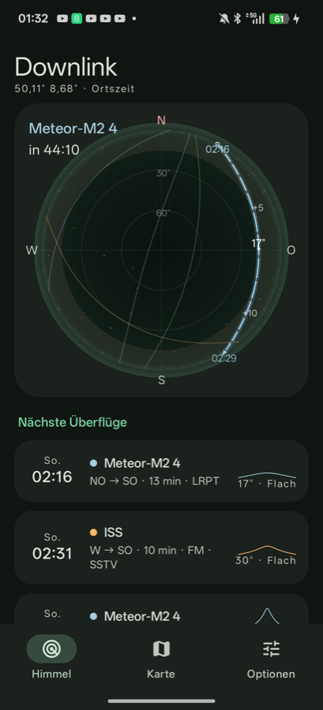
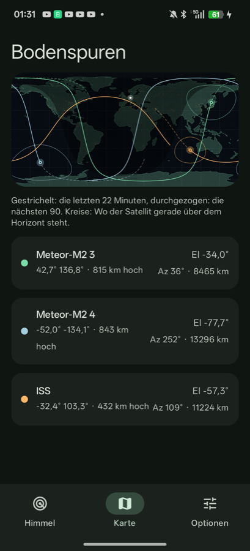
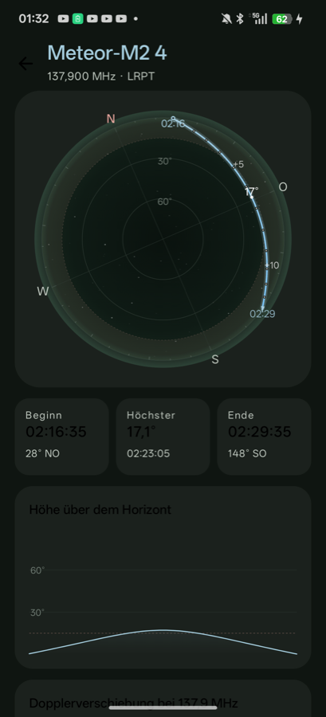

# Downlink

Wetterbilder direkt vom Satelliten: Downlink sagt dir, wann Meteor-M2 3, Meteor-M2 4 und die ISS über dir sind, wohin du die Antenne halten musst und wie stark sich die Frequenz verschiebt.

| Himmel | Karte | Pass |
|---|---|---|
|  |  |  |

## Was drin ist

- **Echte Bahnen**: SGP4 über [predict4java](https://github.com/davidmoten/predict4java), Bahndaten von [CelesTrak](https://celestrak.org), mit Schnappschuss in der App für den ersten Start.
- **Himmelskarte**: Zenit in der Mitte, Bahn mit Minutenmarken, Aufgang, höchster Punkt, Untergang, Sonne, Live-Position; auf Wunsch mit Kompass.
- **Weltkarte**: Bodenspuren, Sichtkreise, Tag-Nacht-Grenze, Nachtlichter.
- **Pass im Detail**: Höhe über die Zeit, Dopplerkurve, Kompassnadel zum Ausrichten der Antenne.
- **Viele Optionen**: Satelliten, Mindesthöhe, Vorschau 24 bis 72 h, UTC, Spurlänge, Sichtkreise, Standort, Bahndaten neu laden.
- **SDR**: startet den rtl_tcp-Treiber für einen RTL-SDR-Stick am USB-C-Anschluss.

## Satelliten

| Satellit | Frequenz | Empfang |
|---|---|---|
| Meteor-M2 3 | 137,9 MHz LRPT | SDR-Stick und V-Dipol |
| Meteor-M2 4 | 137,9 MHz LRPT | SDR-Stick und V-Dipol |
| ISS | 145,8 MHz FM | nur bei SSTV-Aktionen |
| Metop-B, Metop-C | 1701,3 MHz HRPT | Parabolantenne |

Die alten NOAA-Satelliten (15, 18, 19) wurden 2025 abgeschaltet und fehlen deshalb.

## Bauen

```bash
./gradlew assembleDebug
```

## Noch offen

- Aufnahme und LRPT-Dekodierung der Bilder
- Benachrichtigung vor einem Pass
- Eigene Satelliten aus beliebigen TLE

## Quellen

- Bahndaten: CelesTrak
- Küstenlinien: Natural Earth (gemeinfrei)
- Erdbilder: [Solar System Scope](https://www.solarsystemscope.com/textures/), CC BY 4.0, nach NASA-Daten

## Lizenz

GPL-3.0
