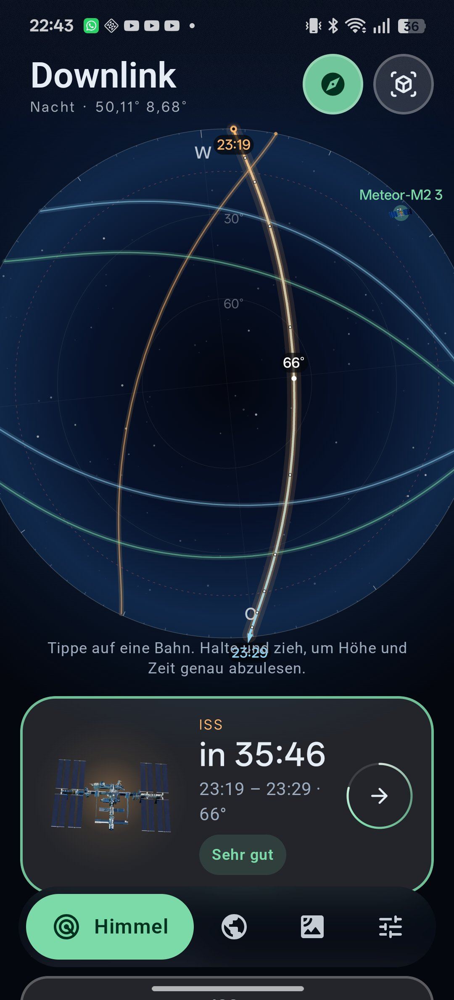
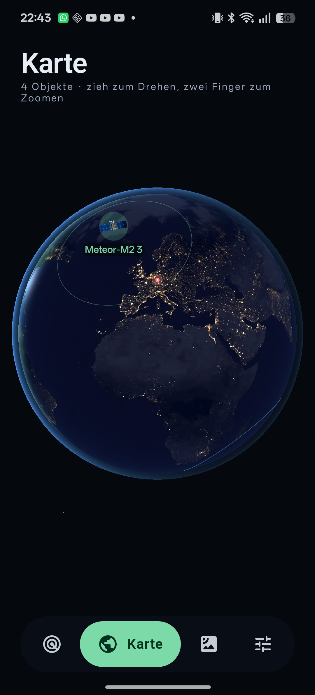
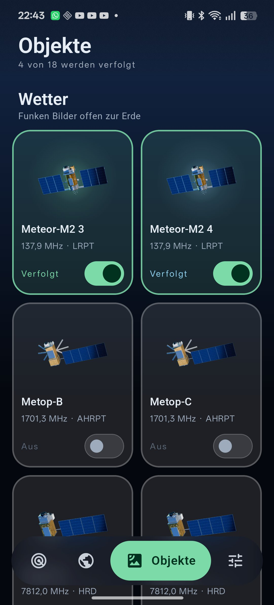
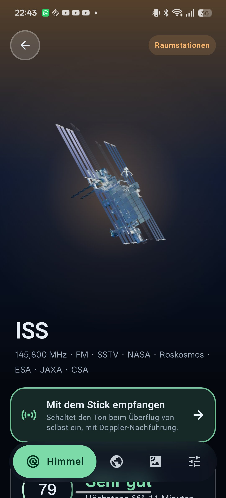
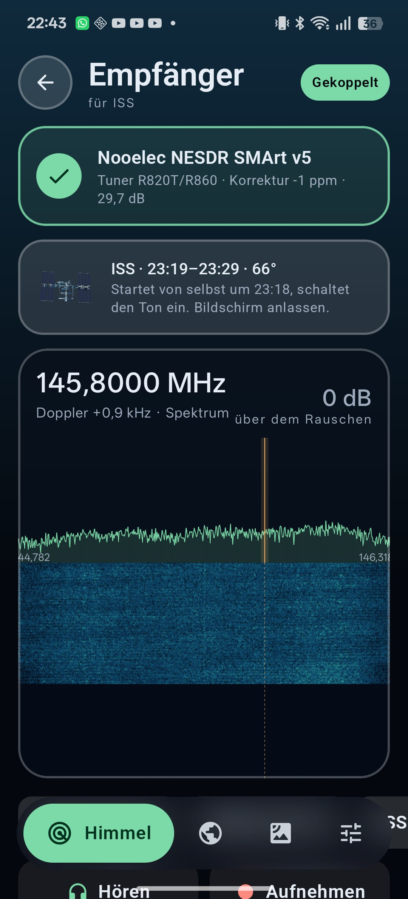
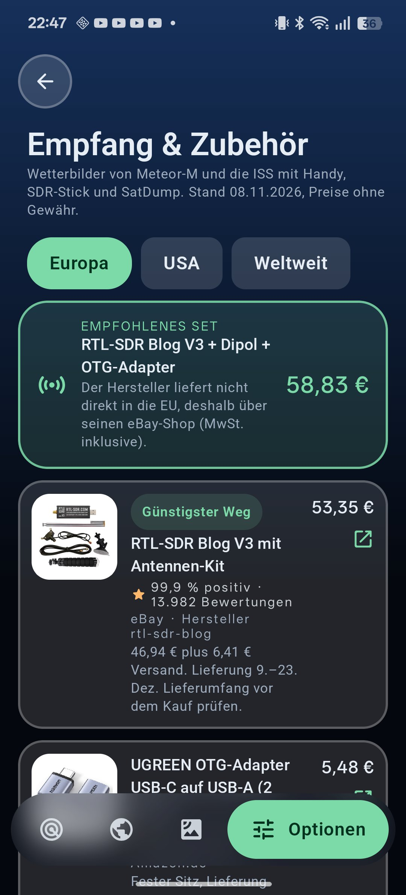
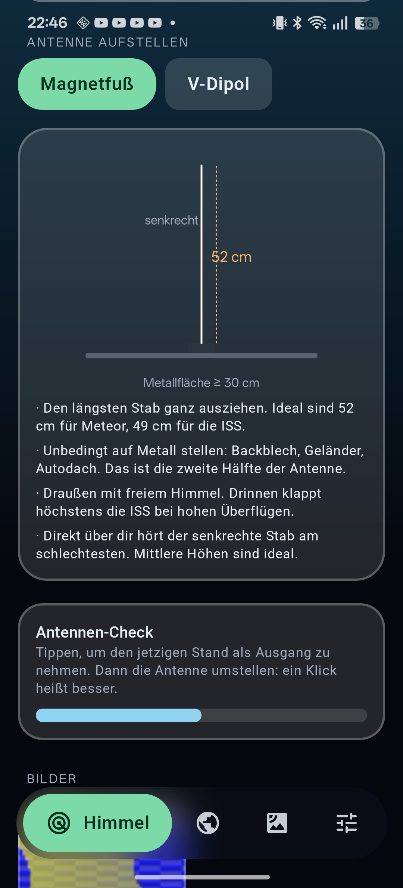
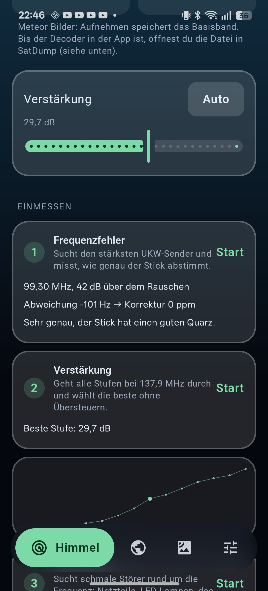
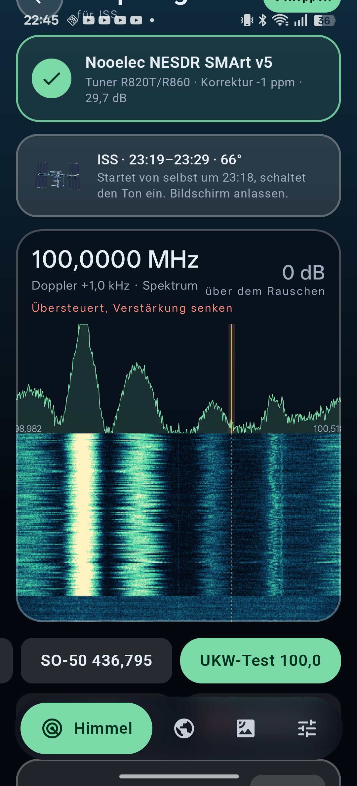

# Downlink

**Wetterbilder direkt vom Satelliten, ohne Internet.**

Wettersatelliten wie Meteor-M funken ihre Bilder offen zur Erde, die ISS sendet auf 145,8 MHz. Downlink sagt dir, wann sie über dir sind, und mit einem kleinen SDR-Stick am Handy empfängst du sie selbst: kein Server, kein Konto, nur das Signal und deine Antenne.

| Himmel | Karte | Objekte | Überflug | Empfänger |
|---|---|---|---|---|
|  |  |  |  |  |

## Was du damit machen kannst

**Nur mit dem Handy**
- Sehen, wann Meteor-M, die ISS, Tiangong, Hubble und 14 weitere Objekte über dir sind, mit Bewertung „Wird es klappen?“.
- Die Bahn am Himmel verfolgen: Kuppel mit Kompass, AR-Ansicht mit der Kamera, 3D-Globus mit Tag und Nacht.
- Die ISS und Tiangong mit bloßem Auge finden, Downlink sagt, wann sie sichtbar sind.
- Erinnerungen vor guten Überflügen, Widget auf dem Startbildschirm.

**Mit SDR-Stick und Antenne**
- Die ISS und Amateurfunksatelliten hören (FM).
- **Echte Wetterbilder von Meteor-M2 3 und M2 4 empfangen.** Downlink nimmt den Überflug auf, decodiert ihn selbst und legt das Farbbild in Fotos ab.
- Den Stick einmessen und die Antenne richtig aufstellen, alles in der App.

## Was du zusätzlich brauchst

| Teil | Wofür | Preis etwa |
|---|---|---|
| RTL-SDR-Stick (z. B. RTL-SDR Blog V3 oder Nooelec NESDR SMArt v5) | der eigentliche Empfänger | 35–50 € |
| Antenne: Magnetfuß-Stab (oft dabei) oder V-Dipol | ISS: Stab reicht. Meteor: V-Dipol deutlich besser | 0–20 € |
| OTG-Adapter USB-C auf USB-A | Stick ans Handy | 5 € |

Empfohlenes Set in Europa: RTL-SDR Blog V3 mit Dipol-Kit und OTG-Adapter, zusammen etwa 59 €. Die App hat unter **Optionen → Empfang & Zubehör → Was brauche ich?** eine Einkaufshilfe mit Links, Preisen und Bewertungen für Europa, die USA und weltweit. Einen V-Dipol kannst du auch aus zwei Kleiderbügeln bauen.



## So funktioniert es

1. **Antenne aufstellen.** Draußen, freier Himmel. Den Stab auf eine Metallfläche stellen (Backblech, Geländer), den V-Dipol waagerecht mit den Armen nach Nord und Süd. Die App zeigt die Maße: 52 cm für den Stab, 2 × 53,4 cm und 120° für den V-Dipol.
2. **Stick einstecken.** Android fragt, ob Downlink den Stick benutzen darf. Die App koppelt ihn, erkennt den Tuner und zeigt sofort Spektrum und Wasserfall.
3. **Einmessen, einmal.** Downlink sucht den stärksten UKW-Sender und misst daran, wie genau der Stick abstimmt. Dann geht es alle Verstärkungsstufen durch und wählt die beste, ohne dass etwas übersteuert.
4. **Überflug wählen.** Auf der Seite des Überflugs „Mit dem Stick empfangen“ tippen, den Bildschirm anlassen. Downlink startet kurz vor dem Aufgang von selbst, folgt dem Doppler und hört nach dem Untergang auf.
5. **Bild ansehen.** Bei Meteor wird die Aufnahme danach decodiert. Das Farbbild erscheint in der App unter „Bilder“ und in Fotos unter „Downlink“, jeder Kanal einzeln dazu.

| Antenne aufstellen | Einmessen | Empfänger |
|---|---|---|
|  |  |  |

## Eine echte Messung

Aufgenommen in einem Zimmer in Offenbach, Nooelec NESDR SMArt v5 mit dem Magnetfuß-Stab, 1,2 m vom Handy entfernt:

- **UKW-Band um 100 MHz:** Spektrum und Wasserfall zeigen die Sender um 99,3 MHz deutlich. Bei 29,7 dB Verstärkung meldet die App „übersteuert“, wie sie soll, denn UKW ist viel stärker als jeder Satellit.
- **Frequenzfehler:** Sender 99,30 MHz, 42 dB über dem Rauschen, Abweichung −101 Hz, Korrektur 0 ppm. Der Stick hat einen genauen Quarz.
- **Verstärkung bei 137,9 MHz:** beste Stufe 29,7 dB. Die Kurve zeigt, wie das Rauschen mit der Verstärkung steigt, die höchste Stufe übersteuert.



Einen echten Meteor-Überflug hat Downlink noch nicht decodiert. Der Decoder ist mit einem nachgebauten Meteor-Signal getestet (siehe Technik). Wenn du ein Bild empfängst oder es nicht klappt, freue ich mich über ein Issue, gern mit der Aufnahme.

## Satelliten

| Satellit | Frequenz | Empfang mit Downlink |
|---|---|---|
| Meteor-M2 3, M2 4 | 137,9 MHz LRPT | SDR-Stick und V-Dipol, Bild in der App |
| ISS | 145,8 MHz FM, 145,825 MHz APRS | SDR-Stick, Stab reicht |
| SO-50, GreenCube, Diwata-2 | 145 und 435 MHz | SDR-Stick |
| Metop-B, Metop-C, NOAA 20, NOAA 21, Suomi NPP | L- und X-Band | Parabolantenne nötig, nur Vorhersage |
| Tiangong, Hubble, Aqua, Terra, Aura, Landsat 8 und 9 | – | Vorhersage und Sichtbarkeit |

Die alten NOAA-Satelliten 15, 18 und 19 wurden 2025 abgeschaltet und fehlen deshalb.

## Technik

- **App:** Kotlin, Jetpack Compose, Material 3, Roboto. Glas-Blur mit [Haze](https://github.com/chrisbanes/haze).
- **Bahnen:** SGP4 über [predict4java](https://github.com/davidmoten/predict4java), Bahndaten von [CelesTrak](https://celestrak.org). Ein Schnappschuss liegt in der App, damit der erste Start ohne Netz geht.
- **Globus:** OpenGL ES 3 auf einer TextureView, Erde mit Tag, Nacht und Atmosphäre.
- **Empfänger:** [librtlsdr](https://gitea.osmocom.org/sdr/rtl-sdr) und [libusb](https://libusb.info), mit dem NDK gebaut. Android gibt den USB-Zugriff frei, die App öffnet den Stick über den Dateideskriptor. Signalverarbeitung (FFT, Mischer, Filter, FM) in Kotlin.
- **Meteor-Decoder:** eigene C++-Implementierung der LRPT-Kette: Matched Filter, Costas-Loop mit FLL, Gardner-Taktrückgewinnung für OQPSK, Viterbi (k=7, r=1/2), CCSDS-Rahmen und Pakete, MSU-MR-Bilddecodierung. Reed-Solomon wird noch nicht zur Fehlerkorrektur genutzt. Der Testsignal-Generator in `tools/lrpt` baut ein Meteor-Signal mit Rauschen und Frequenzversatz nach; bei 1 bis 40 dB holt der Decoder 65 bis 100 % der Bildpakete zurück.
- **3D-Modelle:** Blender Cycles, Pipeline und Modelle in `tools/blender`.

## Bauen

Android SDK mit NDK 29.0.14206865 und CMake 3.31.6.

```bash
./gradlew assembleDebug
```

Für ein signiertes Release stehen Pfad und Passwörter des Schlüssels in `local.properties` (`downlink.keystore`, `downlink.keystore.password`, `downlink.key.alias`, `downlink.key.password`):

```bash
./gradlew assembleRelease
```

## Wie das entsteht

Teile dieses Projekts sind mit einem KI-Assistenten (Claude) geschrieben. Ich lege fest, was die App kann und wie sie aussieht, teste jede Version auf meinem Handy und antworte für jede Änderung.

## Quellen und Lizenzen

- Bahndaten: CelesTrak
- Erdbilder: [Solar System Scope](https://www.solarsystemscope.com/textures/), CC BY 4.0, nach NASA-Daten
- 3D-Modelle: NASA 3D Resources (gemeinfrei) und eigene Modelle (CC0)
- Schrift: Roboto, SIL Open Font License
- librtlsdr (GPL-2.0-or-later) und libusb (LGPL-2.1-or-later), Quelltext in `app/src/main/cpp`
- Die Produktbilder der Zubehör-Seite werden zur Anzeige von den Händlerseiten geladen und gehören den Händlern.

Proudly developed in the European Union.

## Lizenz

GPL-3.0
